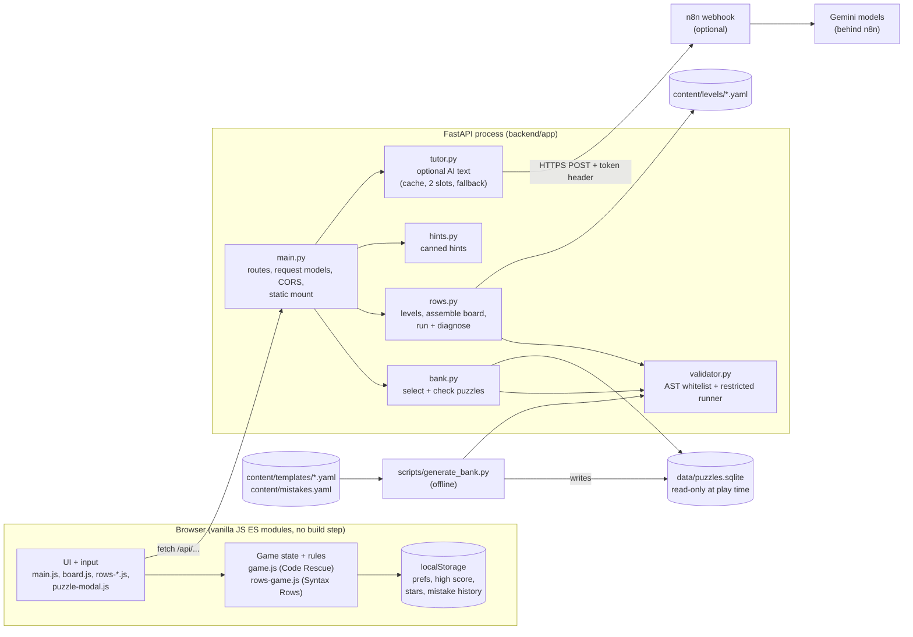
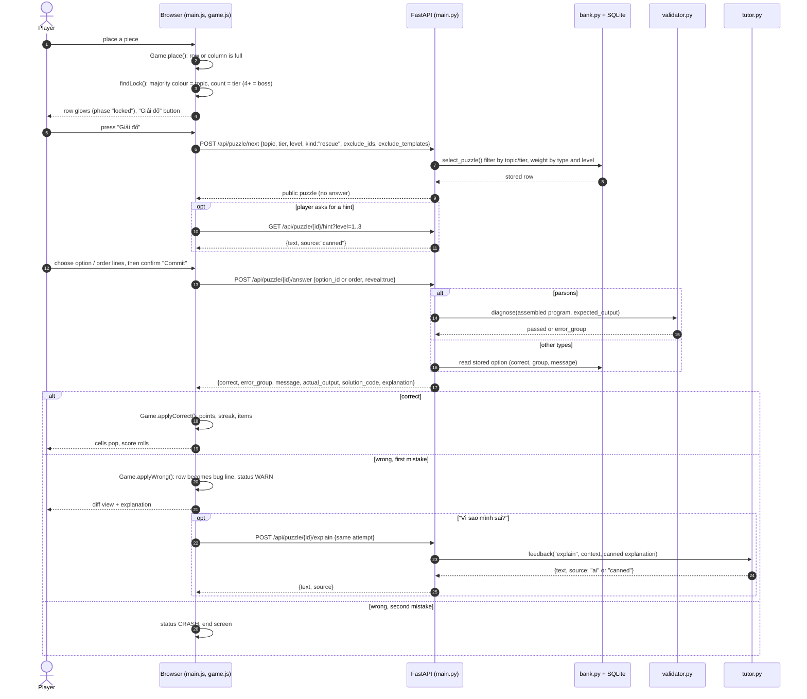
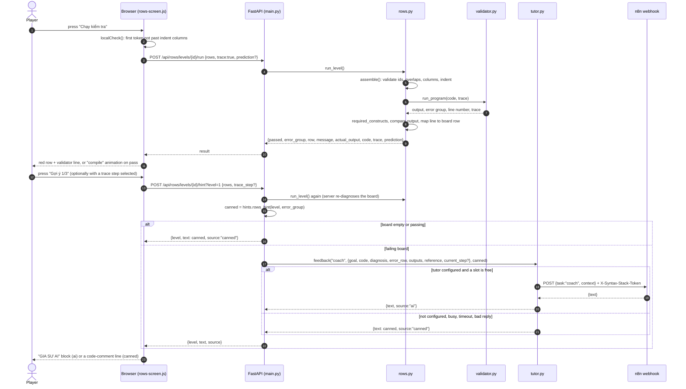

# Architecture

This document describes how Syntax Stack is put together: the components, who owns which piece of
state, how a request travels through the system, and where the trust boundaries are. Everything
here was checked against the code in `backend/app/` and `frontend/js/`.

Related documents: [validator-and-safety.md](validator-and-safety.md), [puzzle-bank.md](puzzle-bank.md),
[syntax-rows.md](syntax-rows.md), [ai-tutor.md](ai-tutor.md), [frontend.md](frontend.md),
[operations.md](operations.md), [api-contract.md](api-contract.md).

## 1. What the system is

Syntax Stack is a browser game that teaches beginner Python. It has two modes that share one
validator:

- **Code Rescue**: an 8x8 block-puzzle. A full row or column is *locked* and the player must solve a
  short code puzzle to clear it. One wrong answer leaves a *bug line*; a second one ends the run.
  Rules: `Code_Rescue_Gameplay_Spec.md`.
- **Syntax Rows**: the board is a program. Each row is one line of Python, the pieces are code
  tokens, and rows only disappear when the assembled program passes. Rules:
  `Syntax_Rows_Gameplay_Spec.md`.

The whole thing is one FastAPI process (`backend/app/main.py`) that serves the JSON API under `/api`
and the static frontend (`frontend/`) at `/`. There is no database for players and no login.

## 2. Components and responsibilities



| Component | File(s) | Responsibility |
| --- | --- | --- |
| HTTP layer | `backend/app/main.py` | Routes, pydantic request models, error-to-status mapping, CORS, static mount. Builds the context that is sent to the tutor. |
| Puzzle bank access | `backend/app/bank.py` | Opens `data/puzzles.sqlite` read-only, selects a puzzle (filters, weights), builds the public view, checks answers. |
| Syntax Rows engine | `backend/app/rows.py` | Loads `content/levels/*.yaml`, turns a board payload into program lines, runs it, diagnoses, maps the error to a board row, builds trace / twist / practice boards. |
| Validator | `backend/app/validator.py` | The only place that executes Python. AST whitelist, restricted builtins, step / time / output limits, error classification, optional execution trace. |
| Hints | `backend/app/hints.py` | Authored three-level hints (`source: "canned"`). |
| Tutor | `backend/app/tutor.py` | Optional natural-language feedback from an n8n webhook. Falls back to authored text. See [ai-tutor.md](ai-tutor.md). |
| Offline generator | `backend/scripts/generate_bank.py` | Expands 16 YAML templates into verified puzzles stored in SQLite. Uses the same validator. |
| Review script | `backend/scripts/review_content.py` | Editorial helper: asks the tutor webhook for a draft, then checks the draft with the validator. Never used at play time. |
| Frontend | `frontend/index.html`, `css/`, `js/` | Rendering, input, game rules for Code Rescue, local progress. See [frontend.md](frontend.md). |

## 3. Who owns which state

The server is stateless between requests. There are no sessions, accounts, attempt counters or
score tables.

| State | Owner | Where it lives |
| --- | --- | --- |
| Puzzles, correct answers, distractor diagnosis | **Server** | `data/puzzles.sqlite` (read-only), never sent to the client before the answer |
| Syntax Rows levels, canonical solutions, which tokens are distractors | **Server** | `content/levels/*.yaml`; `GET /api/rows/levels/{id}` omits solution and `is_distractor` |
| Whether an answer or a board is correct | **Server** | `validator.py` + `bank.check_answer` / `rows.run_level` |
| Error group, error row, actual output, execution trace | **Server** | Returned in the run / answer response |
| Tutor text (AI or canned) | **Server** | `tutor.feedback()` |
| Grid, tray, score, streak, items, mistakes, bug lines, phase | **Browser** | In-memory object from `game.newGame()` (`frontend/js/game.js`) |
| Which puzzles were seen this run, last 3 templates | **Browser** | `seenIds`, `recentTemplates`; sent back as `exclude_ids` / `exclude_templates` |
| Number of attempts at a puzzle (1 in Rescue, 3 in practice) | **Browser** | `maxAttempts` in `puzzle-modal.js`; the server only sees `reveal` |
| Syntax Rows stars, score, number of runs, hints used | **Browser** | `rows-game.js` (`starsFor`, `scoreFor`); best values saved in `localStorage` |
| High score, preferences, Syntax Rows progress, mistake history | **Browser** | `localStorage` (keys in [frontend.md](frontend.md#localstorage)) |

Consequence to be aware of: because the server never counts attempts, the "one answer only" rule
and the star/score rules are enforced by the client. Anyone calling the API directly can retry a
puzzle as often as they like. That is acceptable for this project (no leaderboard, no accounts; the
proposal puts those out of scope), but it means the stored score is not tamper-proof.

## 4. Core principle: the validator decides, the AI explains

Correctness is decided in exactly two places, both deterministic and both server-side:

1. **Code Rescue**: `bank.check_answer()`.
   - `fill_blank`, `predict_output`, `find_bug`: the chosen option carries a `correct` flag that was
     computed when the bank was generated, by running the program through the validator. Distractor
     diagnoses (message, error group, actual output) are stored the same way.
   - `parsons`: the player's arrangement is free-form, so it is assembled into a program and run
     through `validator.diagnose()` at answer time.
2. **Syntax Rows**: `rows.run_level()` assembles the board into a program, runs it with
   `validator.run_program()`, compares the output with the level's `expected_output`, and checks the
   level's `required_constructs` against the AST.

The tutor (`tutor.py`) never takes part in either decision:

- It is only called *after* the result is known (`/explain`, `/rematch`, `/teach-back`, POST
  `/rows/levels/{id}/hint`).
- Its output is a string that is displayed. No code path reads it to set `correct`, `passed`,
  `error_group`, stars or score.
- If it is not configured, slow, busy, or returns something invalid, the endpoint returns authored
  text with `source: "canned"` and the game plays identically.
- The tutor receives the verified diagnosis as input; it does not produce one.

This follows the proposal's "validator confirms, AI explains" rule. Details and the responsible-AI
checklist are in [ai-tutor.md](ai-tutor.md).

## 5. Trust boundaries

```
 [ Player's browser ] ──(1)──> [ FastAPI ] ──(2)──> [ validator.run_program ]
                                  │                     (exec in-process)
                                  └───(3)──> [ n8n webhook ] ──(4)──> [ LLM provider ]
```

| # | Boundary | What crosses | What protects it |
| --- | --- | --- | --- |
| 1 | Browser to API | JSON bodies: option ids, line orders, board placements, a short prediction (<= 240 chars), a short reflection (<= 400 chars). Untrusted: a caller can send anything. | pydantic models in `main.py`; `bank.py` rejects unknown option ids, wrong line sets and indents outside 0..2 (HTTP 422); `rows.assemble()` rejects unknown token ids, duplicates, overlaps, out-of-range cells and rows that start too far right (422). |
| 2 | API to the Python runner | A program string. The player never types code: it is built only from stored fragments (puzzle line text, level token text). | AST whitelist, restricted builtins, step / time / output / size limits. See [validator-and-safety.md](validator-and-safety.md). |
| 3 | API to n8n | A JSON object `{task, context}` with verified game data. | HTTPS URL from env, shared secret header `X-Syntax-Stack-Token`, `trust_env=False` (ignores proxy env vars), 38 s timeout, max 2 concurrent calls. |
| 4 | n8n to the model | The same JSON as a user message plus a system prompt that treats it as data. | Lives in `deploy/n8n-tutor.json`, outside the FastAPI code. |

Two further notes:

- The browser-to-API boundary is not an authentication boundary. There is no per-user identity.
- The frontend inserts all server text with `textContent` / text nodes (see `el()` in `ui.js` and
  `richText()` in `editor.js`), so tutor text cannot inject HTML.

## 6. Sequence: Code Rescue, from lock to clear or bug line



Debug is the same flow with `kind:"debug"` and the failed puzzle's `template_id` (tapping a bug
line). Last Commit uses `kind:"last_commit"`, tier 3. After a run ends, the end screen can call
`GET /api/puzzle/{id}/rematch` to get a different verified variant of the same template and tier
plus a tutor sentence.

## 7. Sequence: Syntax Rows, from run to diagnosis to hint



The hint endpoint does not trust the client's description of the failure. It receives the board,
re-runs it, and builds the tutor context from the fresh diagnosis (`main.py: rows_coach`).

## 8. Live classroom

A teacher opens a room (`POST /api/rooms`), students join with a nickname, and a dashboard polls
`GET /api/rooms/{code}/summary`. The code lives in `backend/app/rooms.py` with its own SQLite file,
`rooms.sqlite`, in the same folder as `SYNTAX_STACK_CUSTOM_DB` (so on the Docker volume).

- **Verified data.** `/api/puzzle/{id}/answer` checks the answer against the bank as always and then, if the
  request carries a valid `room` and `player_token`, records the result (`correct`, named mistake or error
  group) in one cheap insert wrapped in try/except: logging can never fail or slow the answer. Nothing the
  client says about correctness is ever stored; only the leaderboard (`score`, `status`, `bugs_fixed`) is
  client-reported, and it is labelled that way.
- **Names.** A room's `names` mode is `random` (default) or `free`. In `random` mode every student gets a
  generated nickname (`"<animal> <adjective> <NN>"`, `backend/app/nicknames.py` with the friendly word lists in
  `backend/content/nickname_words.yaml`), so no student can type anything onto a projector and no real name is
  needed. In `free` mode the nickname is checked against `backend/content/name_blocklist.yaml` (diacritics,
  look-alikes and repeated letters normalised); that list is never complete, so the teacher can also remove a
  player (`POST /api/rooms/{code}/players/{player_id}/kick`, which deletes the player and their answers).
- **Privacy.** Nicknames only: no names, accounts, emails or IPs are stored (the IP is hashed in memory
  for the 5-rooms-per-hour rate limit only). A room expires 12 hours after the last student activity and
  is purged lazily (on create, join and lookup); the teacher can delete it at once.
- **Secrets.** The teacher key and each player token are 128-bit random values returned once; only their
  SHA-256 is stored. The teacher key (header `X-Teacher-Key`) gates summary, close and delete.
- **Limits.** 60 players per room, 1000 logged answers per player and 20000 per room.
- **Join link.** `SYNTAX_STACK_PUBLIC_URL`, else the proxy's `X-Forwarded-Proto` / `X-Forwarded-Host`, else
  the request's own host; `GET /api/rooms/{code}/qr.svg` renders it with `segno` (pure Python).

## 8b. Ranked runs and races

Ranked play never trusts a score from the browser (`backend/app/ranked.py`, `backend/app/rescue_engine.py`,
contract in [`ranked-and-race.md`](ranked-and-race.md)). A run has a server-chosen seed: the browser deals
the pieces with `mulberry32(seed)` and the server picks every puzzle from the same seed, recording the
puzzle served, the hints opened and the checked answer in `ranked.sqlite` (beside `rooms.sqlite` on the
volume). At the end the browser sends only its move list and `rescue_engine.replay` replays the whole game
with a Python port of `game.js` / `pieces.js`, so the score, locks and streaks are computed on the server.
An illegal move list, or a puzzle the server did not serve for that exact situation, is stored as
`rejected` and never ranked. Races are runs that share one seed (so every racer faces the same pieces and
puzzles) and are kept out of the leaderboard. A Node harness (`backend/tests/js_harness/play.mjs`) plays
hundreds of games with the real `game.js` and the test suite requires the Python replay to match, so the
two implementations cannot drift unnoticed.

## 9. Directory map

```
sextax/
├── README.md                         project overview and quick start
├── Dockerfile, compose.yaml          container build and run (Linux host, port 8000)
├── .dockerignore                     whitelist of files that enter the image
├── .claude/launch.json               dev-server definitions used by the editor tooling
├── Code_Rescue_Gameplay_Spec.md      Code Rescue rules (Vietnamese)
├── Syntax_Rows_Gameplay_Spec.md      Syntax Rows rules (Vietnamese)
├── Syntax_Stack_BTEC_Best_Coder_2026_Proposal.pdf   project proposal (Vietnamese)
├── SERS.pdf                          slide template used for the presentation
├── deploy/
│   └── n8n-tutor.json                importable n8n workflow for the tutor webhook
├── docs/                             this documentation (see docs/README.md)
├── backend/
│   ├── app/                          FastAPI package (main, validator, bank, rows, hints, tutor, custom, rooms, ranked, rescue_engine)
│   ├── content/
│   │   ├── templates/*.yaml          16 Code Rescue templates
│   │   ├── mistakes.yaml             named common mistakes -> short Vietnamese notes
│   │   └── levels/r1..r5.yaml        5 Syntax Rows levels
│   ├── data/
│   │   ├── puzzles.sqlite            generated bank (committed output)
│   │   └── review/                   sample editorial review packet
│   ├── scripts/                      generate_bank.py, review_content.py
│   ├── tests/                        pytest suite (incl. tests/js_harness/play.mjs, the Node golden harness for the replay engine)
│   ├── requirements.txt, pytest.ini, README.md
│   └── .venv/                        local virtual environment (not documented here)
└── frontend/
    ├── index.html                    all screens as <section> elements; loads js/main.js
    ├── css/                          base, game, rows, modal
    └── js/                           ES modules (see frontend.md for the module map)
```

## 10. Known limits of this architecture

- Single process, in-process code execution. Throughput is bounded by one Python interpreter (see
  the threat model in [validator-and-safety.md](validator-and-safety.md#5-threat-model)).
- `tutor.py` keeps its cache and concurrency counter in process memory. Running several uvicorn
  workers would give each worker its own cache and its own 2 slots.
- Persistence is browser-only. Clearing site data resets stars, high score and mistake history.
