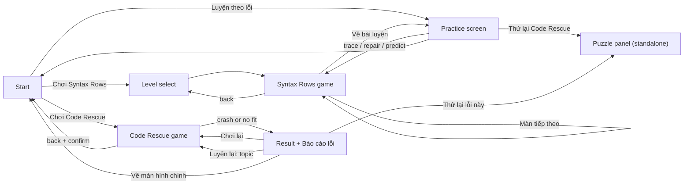
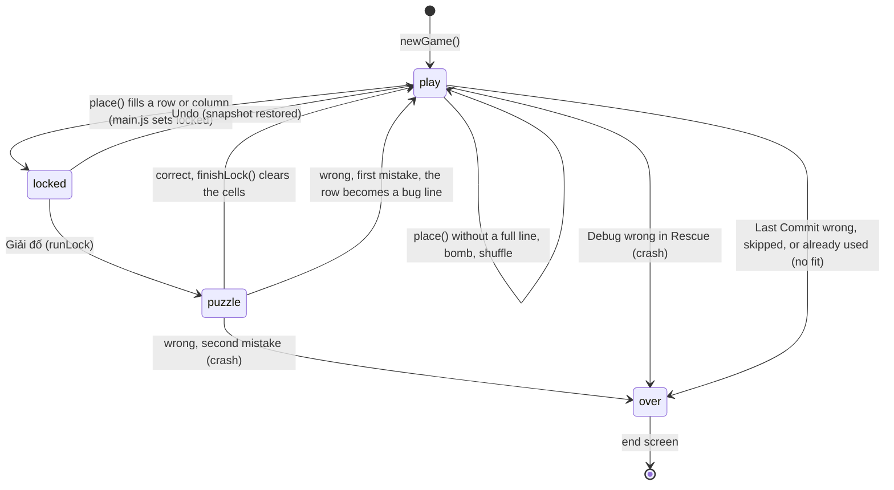
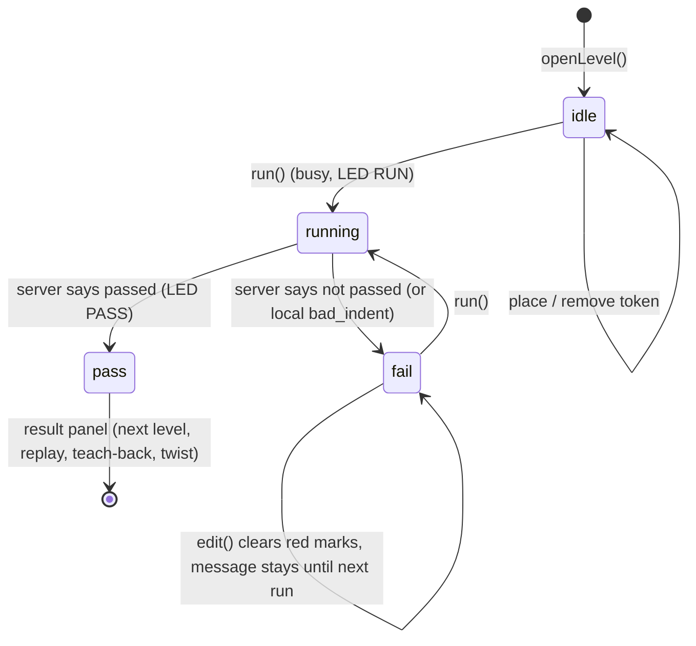

# Frontend

The frontend is plain HTML, CSS and JavaScript ES modules. There is no framework, no bundler and no
build step: `frontend/index.html` loads `js/main.js` as `<script type="module">` and four stylesheets.
FastAPI serves the folder as static files at `/` (`backend/app/main.py`).

Design reference: [design-brief.md](design-brief.md) (v2, "Keycap"). This document describes what the
code actually does. Related: [architecture.md](architecture.md), [syntax-rows.md](syntax-rows.md),
[ai-tutor.md](ai-tutor.md), [api-contract.md](api-contract.md).

Contents: [1 Module map](#1-module-map) · [2 Screens and navigation](#2-screens-and-navigation) ·
[3 Code Rescue state](#3-code-rescue-state-machine-gamejs) · [4 Syntax Rows state](#4-syntax-rows-state-rows-gamejs-and-rows-screenjs) ·
[5 Rendering](#5-rendering-approach) · [6 Pointer drag](#6-pointer-drag-system) · [7 Puzzle modal](#7-puzzle-modal-flow) ·
[8 Editor components](#8-editor-components) · [9 Design system](#9-design-system-as-implemented) · [10 Motion](#10-motion-system) ·
[11 Accessibility](#11-accessibility) · [12 localStorage](#localstorage) · [13 Practice screen](#the-practice-screen) ·
[14 Mock mode and demo hooks](#14-mock-mode-and-demo-hooks) · [15 Open questions](#15-open-questions)

## 1. Module map

All files are in `frontend/js/`. Imports form a tree with `main.js` at the top.

| File | Role | Touches DOM | Touches network |
| --- | --- | --- | --- |
| `main.js` | Boot, screen switching, start screen, practice screen, and the Code Rescue controller that glues `game.js`, `board.js`, `puzzle-modal.js` and the API. Also the `?demo=` hooks. | yes | via `api.js` |
| `game.js` | Pure Code Rescue rules and state: grid, tray, lock detection, scoring, streak, items, bug lines, last commit. | no | no |
| `pieces.js` | Block shapes (13 base shapes with weights, rotations), topic names and glyphs, weighted random piece. | no | no |
| `board.js` | `Board` class for Code Rescue: 8x8 grid, tray, items, keyboard and pointer input, drag ghost, and all board animations. | yes | no |
| `puzzle-modal.js` | `openPuzzle()`: the puzzle panel for the four puzzle types, hints, commit/confirm, result, "why was I wrong". | yes | `api.js` |
| `editor.js` | Editor-window pieces shared by Code Rescue and Syntax Rows: title bar, code block with gutter, terminal, diff view, `# comment`, tutor note (AI vs canned). | yes | no |
| `highlight.js` | Tiny regex-based Python highlighter. | yes | no |
| `rows-game.js` | Pure Syntax Rows rules: placement checks, program preview lines, payload, stars, score, unlock logic. | no | no |
| `rows-board.js` | `RowsBoard` class: sockets, gutter, one keycap per token, tray, pointer/keyboard input, compile animation. | yes | no |
| `rows-screen.js` | Syntax Rows level select and game screen; the editor side panel (code preview, prediction, trace, hints, result, teach-back, twist); `?demo=rows-*` hooks. | yes | `api.js`, `storage.js` |
| `api.js` | The only module that calls `fetch`. Relative URLs; `?mock=1` routes to the mocks. | no | yes |
| `mock-api.js`, `mock-rows.js` | In-browser stand-ins for the API (20 puzzles, 5 row levels). Used only with `?mock=1`. | no | no |
| `storage.js` | `localStorage` wrappers (all in try/catch). | no | no |
| `strip.js` | The header strip: wordmark, mode label, streak, LEDs, score. | yes | no |
| `start.js` | Keycap title, one-time press wave, the two mini previews on the start screen. | yes | no |
| `keycap.js` | The keycap factory, `keycap()` and `setLegend()`. | yes | no |
| `icons.js` | Inline SVG icon map (27 icons) and `icon()`. | yes | no |
| `ui.js` | `el()` element builder, `anim()` (WAAPI with reduced-motion rules), `EASE`, `rollNumber`, `floatText`, `toast`, `confirmDialog`, `wait`. | yes | no |

CSS: `css/base.css` (tokens, reset, keycap, buttons, strip), `css/game.css` (start screen, Code Rescue
board, tray, items, end screen), `css/rows.css` (Syntax Rows), `css/modal.css` (puzzle panel, editor
blocks, tutor note, dialogs).

API calls made by `api.js`:

| Function | Request |
| --- | --- |
| `health` | `GET /api/health` (defined, not called by the UI) |
| `nextPuzzle` | `POST /api/puzzle/next` |
| `submitAnswer` | `POST /api/puzzle/{id}/answer` |
| `getHint` | `GET /api/puzzle/{id}/hint?level=n` |
| `explainChoice` | `POST /api/puzzle/{id}/explain` |
| `rematch` | `GET /api/puzzle/{id}/rematch?level=` |
| `rowsLevels`, `rowsLevel` | `GET /api/rows/levels`, `GET /api/rows/levels/{id}` |
| `rowsRun` | `POST /api/rows/levels/{id}/run` |
| `rowsPractice` | `GET /api/rows/levels/{id}/practice` |
| `rowsTwist` | `POST /api/rows/levels/{id}/twist` |
| `teachBack` | `POST /api/rows/levels/{id}/teach-back` |
| `rowsHint` | `POST /api/rows/levels/{id}/hint?level=n` when an attempt exists, otherwise `GET .../hint?level=n[&error_group=g]` |

Errors: a non-2xx response throws `Error(detail)` using the server's `detail` string. There is no
fetch timeout.

## 2. Screens and navigation

`index.html` contains every screen as a `<section class="screen" id="screen-...">`. `main.js: show(id)`
hides all but one (`hidden` attribute) and scrolls to the top. The strip (`#strip`) is shared and
shown or hidden by `strip.js: showStrip`.

| Screen id | What | Strip | Entered from |
| --- | --- | --- | --- |
| `screen-start` | Keycap title, two mode cards, level and mode keys, Học / Thi đấu / Giáo viên links, high score | hidden | boot, any "Về màn hình chính" |
| `screen-practice` | Practice screen (section 13) | plain | start buttons |
| `screen-game` | Code Rescue: board, tray, items, legend; puzzle panel overlays it | shown, back = confirm exit | start card "Chơi Code Rescue", end screen buttons |
| `screen-end` | Code Rescue result: score, receipt, "Báo cáo lỗi", practice keys | hidden | `finish()` after crash or no-fit |
| `screen-rows-select` | Syntax Rows level list with stars, rules and star table | shown, back = home | start card "Chơi Syntax Rows" |
| `screen-rows` | Syntax Rows game: goal, board, tray, editor side panel | shown, back = level select (or the practice screen) | level key, "Màn tiếp theo", practice items |



Level (`beginner`, `intermediate`, `advanced`) and mode (`rescue`, `practice`) are radio keys on the
start screen, saved in `localStorage`. They affect Code Rescue only. Syntax Rows ignores them.

## 3. Code Rescue state machine (`game.js`)

State is one plain object from `Game.newGame({mode, level, focusTopic, rng})`. The fields that drive
the flow:

| Field | Meaning |
| --- | --- |
| `phase` | `play`, `locked`, `puzzle`, `over` |
| `status` | `ok`, `warn`, `crash` (LED), derived by `refreshStatus` |
| `mistakes` | Rescue only: 0 stable, 1 warning |
| `grid` | 8x8 of `null` or `{topic, bug, bugId}` |
| `tray` | 3 pieces (or `null` when placed); refilled when all three are used |
| `lock` | `{rows, cols, cells, count, tier, boss, topic}` while a row or column is full |
| `bugLines` | `{id, cells, topic, templateId, placementsLeft}` |
| `score`, `streak`, `bestStreak`, `items{bomb,shuffle,undo,debugger}`, `bugsFixed` | scoring and items (each item capped at 3) |
| `seenIds`, `recentTemplates`, `wrongLog`, `topicMisses` | puzzle bookkeeping and the end report |
| `snapshot` | state before the last placement, for Undo |



`phase` only has these four values. Debug puzzles (tapping a bug line) and Last Commit puzzles are
shown while `phase` is still `play`; the `busy` flag in `main.js` blocks input meanwhile.

Notes on how `main.js` drives it:

- `place()` (in `game.js`) only *computes* the lock. `main.js` then sets `phase = 'locked'`. While
  locked, the tray is disabled and the lock banner offers "Giải đố" (and "Hoàn tác" if an Undo item
  and snapshot exist).
- A re-entrancy flag `busy` in `main.js` ignores input during animations and API calls. Every entry
  point checks `busy` and `phase`.
- Tier of the puzzle: `Math.min(count, 3)` where `count` = full rows + full columns. `count >= 4` is
  a Boss: two tier 3 puzzles in a row, both must be right.
- Topic of the puzzle: the majority topic among the cells of the lock; ties are broken with `rng`.
- Points: `Math.round(base * HINT_FACTOR[penaltyLevel] * streakFactor(newStreak))` with
  `BASE_POINTS = [0, 100, 250, 450, 700]`, `HINT_FACTOR = [1, 0.9, 0.75, 0.5]`; streak factor 1 /
  1.2 (streak 2) / 1.5 (3 to 4) / 2 (5+). A clean answer (no penalised hint) increases the streak;
  otherwise it restarts at 1 for the multiplier and the stored streak becomes 0. Beginner has Hint 1
  free; an active Debugger item makes Hint 2 free. +1 point per placed cell, +150 for fixing a bug.
- Items: Bomb at streak 3, Shuffle at streak 5, Undo for a 4+ clear, Debugger for fixing a bug.
- Practice mode: no crash (a wrong Rescue answer only makes a bug line, a wrong Debug leaves it),
  3 attempts per puzzle, bug lines vanish after 5 placements (`PRACTICE_BUG_LIFETIME`), pieces favour
  topics the player missed (`pieceWeights`), no high score. When nothing fits, the 3 fullest rows are
  cleared, then the whole grid.
- `Game.anyFit` decides "no space". The player is then offered Last Commit once per game.

## 4. Syntax Rows state (`rows-game.js` and `rows-screen.js`)

`rows-game.js: newState(level)`:

| Field | Meaning |
| --- | --- |
| `level` | the object from `GET /api/rows/levels/{id}` |
| `placed` | `{tokenId: {row, col}}` |
| `runs` | number of runs including the passing one |
| `hintsMax` | highest number of hints opened (drives stars) |
| `ctxGroup`, `hintsShown` | the error group the visible hints belong to and their texts |
| `lastGroup`, `errorRow` | last diagnosis |
| `passed`, `result` | pass flag and `{stars, score, unused, runs, hints}` |

`rows-screen.js` holds a game object `G = {state, concept, busy, view, resp, parts, baseline, returnTo,
next, hintBusy, note, trace, traceIndex, lastAttempt, passTerm}`. `view` is `idle`, `fail` or `pass`.



What a run does (`run()`): local check for rows that start past the indent columns (no network);
otherwise `POST /run` with `trace: true` and the prediction if the prediction panel is open. On
failure: red row and gutter, validator line, trace panel (if steps), the error group becomes the hint
context. On pass: stars and score are computed, saved by `recordRowsResult` (not for practice or twist),
the rows "compile" animation plays and the terminal types the output.

Any board edit (`edit()`) clears the trace, the prediction result and the red marks. The code
preview, gutter and trace share the same row numbers as the board.

Modes inside the same screen: normal level; **practice** (`returnTo` set: starts from `/practice`
rows or from saved rows, records nothing); **twist** (`baseline` set: the goal text changes, hints are
hidden, runs go to `/twist`).

## 5. Rendering approach

- No virtual DOM and no templating library. Every DOM node is created with `el(tag, props, ...children)`
  from `ui.js`, which sets text with `textContent`/text nodes (never `innerHTML`; the only
  `innerHTML` is the icon template in `icons.js`, built from the hard-coded icon map).
- **Retained elements, re-synced on state change.** `Board` builds its 64 cells and their keycaps once
  (`build()`), then `render(state, ui)` rewrites class names, legends and `aria-label`s from state.
  Tray slots are rebuilt only when the piece id changes. `RowsBoard.setLevel()` creates one keycap per
  token once; `render()` moves each element between the grid and the tray by setting its
  `grid-row`/`grid-column` and re-parenting.
- **Rebuild small, keep scroll.** `puzzle-modal.js` rebuilds its body from the local state object on
  each interaction (`render()`), restoring `scrollTop`. The Syntax Rows side panel updates its parts
  (`renderCode`, `renderPane`, `renderActions`, `renderTrace`).
- **Layout is CSS grid**: the 8x8 board uses `grid-template-columns: repeat(8, minmax(0,1fr))` and a
  CSS container (`container-type: inline-size`) so a keycap's unit `--u` is
  `(100cqw - 7 * gap) / 8`. Syntax Rows tokens use `grid-column: <col+2> / span <w>`; column 1 is the
  row-number gutter.
- Breakpoints: 720 px (spacing) and 1024 px (two columns; the puzzle panel docks beside the board).
  Phone layout is a single column with a 16 px gutter.
- The state objects hold no DOM references, so game rules can be read in `game.js` and `rows-game.js`
  without any browser APIs.

## 6. Pointer drag system

Both boards use the same pattern (`board.js: onDown/onMove/onUp`, `rows-board.js` equivalents).

1. **Capture and guards.** `pointerdown` on a piece: ignore non-primary buttons (`e.button > 0`) and
   phases other than `play`. For a mouse, `preventDefault()` and clear the text selection, so the
   browser does not start a native drag-and-drop that would steal the pointer. If a previous drag
   never finished, `onUp(e, true)` cleans it up first. Then `setPointerCapture(pointerId)` and add
   `is-dragging` to `<html>` (CSS disables text selection everywhere while dragging).
2. **Listeners live on the piece element**: `pointermove`, `pointerup`, `pointercancel` and
   `lostpointercapture`. The last two both count as *cancel*. A local `done` flag makes cleanup run
   exactly once and removes all four listeners.
3. **Tap versus drag.** Movement under 6 px is a tap: on the tray it toggles the selected piece, on
   the Syntax Rows board a token returns to the tray. Beyond 6 px the drag starts.
4. **Ghost.** `startGhost()` appends a `.ghost` clone (copies of the keycaps, sized from the real cell
   metrics read once at drag start with `getBoundingClientRect`) to `document.body` with
   `aria-hidden`. It is moved with `transform: translate(x, y) scale(1.04)` only, so no layout runs
   per pointer move. The source piece gets `.dragging` (30 % opacity). On touch, the ghost is lifted
   64 px (Code Rescue) or 52 px (Rows) above the finger so it is visible.
5. **Preview.** Code Rescue computes the top-left cell with `Math.round((left - boardLeft) / step)`
   and, if `canPlace`, adds `pv-ok` to the target cells and sets `--pv` to the topic cap colour; if
   not, no preview and the ghost gets `.bad` (red tint). Syntax Rows finds the row from the ghost's
   vertical centre and calls `fitCol(state, id, row, col, 2)`: the nearest valid column within 2
   columns. Hovering the tray area means "return to tray".
6. **Release.** Cancelled (pointer cancel or capture lost): nothing is placed and no feedback. Valid
   target: `onPlace`. Invalid Code Rescue drop: the board shakes. A token dropped on the tray from the
   board is removed.
7. **Touch behaviour.** Pieces and tokens have `touch-action: none` (`.piece`, `.rk`) so the page does
   not scroll while dragging; the boards use `touch-action: manipulation`.
8. **Alternatives to dragging**: tap a piece, then tap a cell (Code Rescue) or a socket (Syntax Rows),
   and keyboard (section 11).

The Parsons widget in the puzzle panel has its own small vertical drag (`startDrag` in
`puzzle-modal.js`): it reorders `<li>` elements by comparing `clientY` with each sibling's midpoint
and listens on `window` for move, up and cancel. The same order can be changed with the up/down
keycaps.

## 7. Puzzle modal flow

`openPuzzle(opts)` returns a Promise that resolves to `{correct, maxHint, response}` when the player
presses "Tiếp tục". `main.js` awaits it for locks, Debug, Last Commit, rematch and practice.

Options: `puzzle`, `topic`, `title`, `boss`, `tag`, `maxAttempts` (1 in Rescue, 3 in practice),
`free` (free hint level), `penalties`, `awardText`, `onResult`, `standalone` (rematch and practice),
`intro`/`introSource` (tutor sentence), `closeLabel`.

Internal phases: `answer`, `confirm`, `sending`, `result`.

1. **Open.** Layer is appended to `#modal-root`; `#app` gets `inert = true`, the game screen gets
   `dim`, `body.modal-open`. On desktop (>= 1024 px) the panel docks over the side column
   (`--dock-x/y/w` from the column's rect, recomputed on resize); on phones it is a bottom sheet.
   Focus moves to the panel (`role="dialog"`, `aria-modal`). Enter animation: 260 ms translateX(24px)
   on desktop, 340 ms `translateY(100%)` with the drawer easing on phones.
2. **Answer.** Widgets per type: `fill_blank` (code with a dashed inline blank that shows the chosen
   fragment, expected output terminal, option keycaps), `predict_output` (code, option keycaps),
   `parsons` (reorderable lines with indent and move keycaps, live program preview) and `find_bug`
   (the program as tappable lines that filter the options by line; each option shows "dòng N"). Hints:
   "Gợi ý n/3 · penalty", fetched with `GET /hint`, appended as `# comment` lines.
3. **Commit.** If `maxAttempts === 1` pressing "Chạy kiểm tra" shows the confirm row "Commit câu trả
   lời này? Chỉ có 1 lần." with "Commit" and "Xem lại". With more attempts it submits directly.
   Enter (when focus is not on a button, input or link) triggers the current primary action.
4. **Submit.** `payload(reveal)` sends `reveal: true` on the final attempt. A network error restores
   the attempt and shows an inline error. A wrong answer with attempts left shakes the panel and
   shows the server message; the final attempt or a correct answer goes to `result`.
5. **Result.** Correct: check on the tab, Matcha edge flash, points text, optional "Vì sao mình
   sai?" if an earlier attempt was wrong. Wrong: message, actual output terminal, a line diff of the
   player's code against `solution_code`, the explanation as a comment, "Vì sao mình sai?" (calls
   `/explain`; result shown through `tutorNote`). `correctOptionId()` highlights the right option by
   comparing the solution with each option's resulting program.
6. **Close.** `finish()` resolves the Promise first (so the next animation starts immediately), then
   animates out in 180 ms, removes `inert`, `dim` and `modal-open`. Escape only closes standalone
   panels.

The puzzle panel posts `option_id` for fill/predict/find_bug (plus an ignored `line_id` for
find_bug) and an `order` list for parsons.

## 8. Editor components

`editor.js` provides the "editor window" look from the design brief:

| Export | What it renders |
| --- | --- |
| `FILE_NAMES` | `variables: bien.py`, `conditions: dieu_kien.py`, `loops: vong_lap.py`, `functions: ham.py` |
| `titleBar({file, meta, check})` | tab with a file icon and name, optional check mark, mono meta label (`tier 2/3`, `BOSS 1/2`, `lần chạy 3`) |
| `codeBlock(lines, {slot})` | line-number gutter plus highlighted code; with `slot`, `___` becomes an inline dashed socket |
| `terminal(output, {label, cls})` | `$ python main.py` prompt line and the output |
| `diffView(player, solution)` | LCS line diff, `-` red, `+` Matcha, context muted; removals grouped before additions |
| `comment(text, cls)` | `# text` in muted italic mono |
| `tutorNote({text, source, context, loading})` | AI block or canned comment (see [ai-tutor.md](ai-tutor.md#7-how-the-frontend-labels-ai-versus-canned-text)) |

`highlight.js: highlightPy(line)` returns a fragment with `sx-kw`, `sx-str`, `sx-num`, `sx-fn`,
`sx-cm` spans from one regular expression (keywords, strings, numbers, identifiers followed by `(`
as functions, comments). It is a display aid, not a parser.

## 9. Design system as implemented

Source of truth for values is `css/base.css` `:root`; rationale is in [design-brief.md](design-brief.md).

| Area | Implementation |
| --- | --- |
| Surfaces | `--bg #141518`, `--case #1d1f24`, `--case-hi #2a2d34`, `--plate #0f1013`, `--line`, `--text #ece8df`, `--muted`, `--faint`; a 3 % film-grain SVG on `body::before` |
| Status | `--ok #7ee081`, `--warn #ffc447`, `--crash #ff5d5d`, `--led-off` |
| Topic colours | classes `.t-variables` (Matcha), `.t-conditions` (Mustard), `.t-loops` (Coral), `.t-functions` (Ice), `.t-neutral`, `.t-bug`, each setting `--cap`, `--skirt`, `--legend`; also `--cap-<topic>` vars for effects |
| Syntax colours | `--syn-kw`, `--syn-str`, `--syn-num`, `--syn-fn` |
| Easing | `--ease-out`, `--ease-in-out`, `--ease-drawer` (same values as `EASE` in `ui.js`) |
| Radii and size | `--r-key 7px`, `--r-cap 6px`, `--r-case 18px`, `--r-panel 14px`, `--r-ctl 8px`, `--strip-h 52px`, `--gutter 16px` |
| Fonts | `--f-display` Bricolage Grotesque 800, `--f-ui` Be Vietnam Pro 400/600, `--f-mono` JetBrains Mono 500/700, each with a system fallback stack. Loaded from Google Fonts in `index.html` with `subset=vietnamese`. |
| Ligatures | `*, *::before, *::after { font-variant-ligatures: none !important; font-feature-settings: "liga" 0, "calt" 0 !important; }` so `>=`, `==`, `!=` stay as typed |
| Numbers | `font-variant-numeric: tabular-nums` on `body` |
| Focus | no default ring; `:focus-visible` gets a 2 px Mustard outline with 2 px offset |

**The keycap** (`keycap.js` + `.key` in `base.css`): `.key` (skirt colour, 4 px bottom padding)
contains `.cap-top` (cap face with a radial highlight and a 1 px inner highlight) containing
`.legend` (top-left, mono 700, size scales with `--u`) or `.kb-label` (inline UI label). A
`.key::before` layer carries the drop shadow so a press can change only its opacity. Pressed state:
`.cap-top` moves down 2 px, shadow opacity drops; 90 ms down, 140 ms up. Hover (only in
`@media (hover: hover) and (pointer: fine)`): 1 px rise, +4 % brightness. Width in units: tokens set
`--w` and keycaps span grid columns. `enter: true` adds the `↵` icon at the bottom right (the
"Chạy kiểm tra" key). The bug cap (`.t-bug`) sits 1 px lower and has an SVG crack drawn in a
`::after`. Empty sockets draw a stem cross using two gradients on `.cell` / `.sock`.

**Icons** (`icons.js`): 27 hand-written 24-grid paths, stroke 1.75, round joins, `currentColor`, no
emoji anywhere. `icon(name, {size, cls, fill})` throws on an unknown name.

**Chips** are squared (4 px radius); pills are not used except the LED housing as in the brief.

Differences from the brief worth knowing: Syntax Rows reuses the strip LEDs with the labels RUN, FAIL
and PASS; the start screen has the "Luyện theo lỗi" entry and the practice screen;
the "AI" badge and tutor block (section 8 of [ai-tutor.md](ai-tutor.md)) and the
trace panel are not in the brief.

## 10. Motion system

Three easing tokens (`--ease-out`, `--ease-in-out`, `--ease-drawer`) mirrored in `ui.js: EASE`.

**Which tool is used for what**

| Tool | Used for | Examples |
| --- | --- | --- |
| CSS transitions | State that the user can interrupt or repeat | keycap press and hover, LED colour, piece select lift, parsons card indent, sockets and row highlight opacity |
| WAAPI `el.animate()` via `anim()` | One-off sequences that are triggered by code | placing, clearing, bug conversion, crack, crash, tray refill, panel in/out, toast, dialog, compile, stars, validator line |
| CSS keyframes | Ambient loops and entrances | `screen-in` (240 ms), caret blink (1.1 s, `steps(1,end)`), `led-blink`, lock `breathe`, tutor dots |
| `requestAnimationFrame` | Score roll (`rollNumber`, 400 ms, cubic ease-out) | strip score |

Only `transform`, `opacity`, `filter` and `clip-path` are animated. `transition: all` is not used.

**Timings in the code**

| Moment | Code | Timing |
| --- | --- | --- |
| Place | `board.animatePlace` | drop 120 ms ease-out, then 2 px press 90 ms (delay 100 ms), 12 ms stagger per cell |
| Tray refill | `renderTray` | 220 ms, delays 0 / 40 / 90 ms |
| Lock | `syncLock` | sweep via `clip-path` 380 ms ease-in-out, then CSS `breathe` glow |
| Puzzle open / close | `openPuzzle` | desktop 260 ms translateX(24px); phone 340 ms drawer easing; close 180 ms |
| Clear (correct) | `animateClear` | 260 ms per cap, stagger `min(22, 560/n)` ms from the last placed piece; floating `+points` 700 ms |
| Bug line | `animateBug` | shake 300 ms, blur crossfade 100 ms each way |
| Debug fixed | `animateCrack` | two clipped halves drift 320 ms |
| Crash | `animateCrash` | 120 ms flicker, then caps fall 700 ms with `cubic-bezier(.5,0,.75,0)`, 30 ms stagger per row |
| Rows run fail | `flagError` | error row shakes 200 ms; validator line slides in 200 ms |
| Rows pass | `animateCompile` | per row: 120 ms flash then 260 ms lift, rows start 200 ms apart; output typed at up to 20 ms/char (cap 600 ms); stars settle 320 ms with scale 1.15 |

**Reduced motion** (`prefers-reduced-motion: reduce`): `anim()` removes every transform keyframe and
keeps only `opacity`/`filter` changes, capped at 150 ms, or does nothing if none remain; `rollNumber`
sets the value directly; the typed output appears at once; clear and crack wait 100 to 150 ms so
state changes remain visible; the crash fall is replaced by the flicker; CSS turns `screen-in` into a
150 ms fade, stops the caret, and removes the keycap press transform (colour and opacity remain).

## 11. Accessibility

- **Keyboard play.** Code Rescue board (`role="grid"`, `tabindex="0"`): arrow keys move a cursor
  (shown with a `kb` class and a live preview), Enter or Space places the selected piece (or taps a
  bug line, or detonates the bomb), keys `1`, `2`, `3` select tray pieces. Tray pieces are buttons
  (`aria-pressed`). Syntax Rows board: arrows move, Enter or Space places the selected token or
  removes the token under the cursor, Escape deselects; tokens are buttons and a keyboard activation
  (`click` with `detail === 0`) selects or returns them. The trace panel steps with the left and right
  arrow keys (not when focus is in an input, the board or the tray). Parsons lines have explicit
  up, down, indent and outdent keycaps with descriptive `aria-label`s.
- **Focus management.** Modals set `inert` on `#app` so focus cannot leave; the dialog card or panel
  takes focus on open; the result's "Tiếp tục" is focused when the result appears; the end screen and
  practice screen focus their `h1` (`tabindex="-1"`); buttons that start async work are re-focused
  afterwards. Focus ring is Mustard, keyboard only.
- **Live regions.** The strip LEDs (`role="status"`, `aria-live="polite"`, label changes per state), the
  toast root (`aria-live="polite"`), hint lists, the trace step, the prediction result (`role="status"`),
  the result panels (`role="status"`), validator lines and inline errors (`role="alert"`), the tutor
  note (`role="group"`, labelled), the "Lượt thử" attempt dots (`role="img"` with the attempts
  left).
- **Labels.** Each board cell and socket has an `aria-label` ("Hàng 3, cột 4: Vòng lặp"); pieces
  announce topic and size; stars have text alternatives. `<html lang="vi">`.
- **Targets and gestures.** Interactive controls have a 44 px minimum height (keys, `.btn`, icon
  buttons). Every drag has a tap-and-keyboard alternative.
- **Not covered by code:** there is no "skip to content" link and no screen-reader announcement of
  the Code Rescue score changes beyond the strip. (Observation from the code; not audited with a
  screen reader.)

## localStorage

All access is wrapped in `try/catch` (`storage.js`); the game works with storage blocked.

| Key | Value | Written by |
| --- | --- | --- |
| `syntaxstack.rescue.highscore` | number as string; only updated when higher | `setHighScore` at the end of a Rescue run |
| `syntaxstack.rescue.prefs` | JSON `{"mode":"rescue\|practice","level":"beginner\|intermediate\|advanced"}` | start screen radio keys |
| `syntaxstack.rows.progress` | JSON `{ "r1": {"stars": 3, "score": 400}, ... }`, best values | `recordRowsResult` on a normal pass |
| `syntaxstack.practice.mistakes` | JSON array of the last 40 mistakes: `{topic, puzzleId}` from Code Rescue wrong answers (non-standalone, non-mock) and `{topic, levelId, errorGroup, rows}` from Syntax Rows failures (not practice, twist or `empty`) | `recordMistake` |

`sessionStorage` key `ss.wave` marks that the title key wave already played in this tab.

The mistake history includes the player's board (`rows`) so "Sửa lỗi trên bàn" can restore it. Nothing
in storage is ever sent to the server.

## The practice screen

"Luyện theo lỗi" on the start screen opens `screen-practice` (`main.js: showPractice()`).

**"Luyện theo lỗi"** uses the learner's history. `storage.practiceFocus(topics)` takes the last 40
mistakes, counts them by topic and picks the most frequent. The level is `r4` when the topic is loops
and the most recent Syntax Rows error was `bad_indent`; otherwise the saved level id if it is one of
`r1`..`r5`; otherwise a default per topic (`variables: r1`, `conditions: r2`, `loops: r3`, `functions:
r5`). With no history the focus is loops. Three items:

1. **Xem từng bước**: opens that level with the authored mistake board (`GET .../practice`), runs it
   and opens the trace panel.
2. **Sửa lỗi trên bàn**: opens the board the learner failed with if it is for the same level, else the
   authored mistake board; the learner fixes it and runs.
3. **Thử lại Code Rescue**: takes the remembered puzzle id (or a new beginner tier 1 puzzle of the
   topic), calls `GET /rematch`, and opens the verified variant in a standalone puzzle panel with the
   tutor sentence.

There is no separate judge-demo button or practice variant. The legacy `?demo=judge` URL opens
ordinary history-based practice.

Practice sessions do not write stars, progress or mistake history (`returnTo` is set), and the
standalone puzzle panel does not record mistakes.

### Presenter keyboard shortcuts

From the home screen, while focus is outside an input/editor:

| Shortcut | Opens |
| --- | --- |
| `Ctrl+Alt+1` | The ordinary classroom creation form; the presenter still opens a real room. |
| `Ctrl+Alt+2` | The ordinary custom-code editor; the presenter still pastes code and generates puzzles. |
| `Ctrl+Alt+3` | Level r3's authored practice board (`range(2)`, indented `print(i)`) with prediction expanded, before Run. |

The r3 shortcut uses `openPracticeRows`, so it does not overwrite stars or mistake history and still
uses the real validator and tutor. Shortcuts ignore held-key repeats, composition and editable fields;
they only work from home, so they cannot abandon a live match or reset work already on screen.
Prepare three tabs before presenting, then use the browser's `Ctrl+1`, `Ctrl+2`, `Ctrl+3` to switch
between them. See the timed rehearsal in [presentation-script.md](presentation-script.md).

## 14. Mock mode and demo hooks

### Mock mode

`?mock=1` makes `api.js` import `mock-api.js` and `mock-rows.js` instead of calling the server. It
exists so the UI can be developed and screenshotted without the backend:

```bash
python -m http.server 5173 -d frontend     # then open http://localhost:5173/?mock=1
```

(`.claude/launch.json` has this as `frontend-mock`.) The mocks hold their own answers in the browser
(`mock-api.js` says so in its header), so mock mode is for UI work only, never for judging
correctness. Coverage:

| Feature | In mock mode |
| --- | --- |
| Puzzles | 20 hand-written puzzles (`nextPuzzle`, `submitAnswer`, `getHint`, `rematch`), no real validator |
| Explain | built from the mock answer's explanation, `source: "canned"` |
| Rows levels, run, hints | 5 mock levels; run has **no trace**; `prediction` is evaluated in `api.js` |
| Teach-back | fixed Vietnamese question, `canned` |
| `rowsPractice`, `rowsTwist` | **not mocked**: they always call the real server |
| Mistake history | not recorded |

### URL hooks

| Parameter | Effect |
| --- | --- |
| `mock=1` | use the in-browser mocks |
| `diag=1` | adds a hidden `<pre id="errlog">` collecting runtime errors, unhandled rejections, `console.error` text and, after 3.5 s, `W <scrollWidth>/<innerWidth>` for overflow checks (used by headless checks) |
| `mode=rescue\|practice`, `level=beginner\|intermediate\|advanced` | used by the Code Rescue demo hooks below |
| `demo=board` (or any value not listed below, such as `lock`) | start Code Rescue with a prepared board: mixed topics, one bug line, score 1240, streak 3, one Bomb, one Undo, state WARN; the random generator is seeded (`mulberry(7)`) so trays repeat |
| `demo=lock` | the same board with row 5 completed and the lock open |
| `demo=puzzle-fill-blank`, `puzzle-predict-output`, `puzzle-parsons`, `puzzle-find-bug` | as `lock`, then open a puzzle of that type immediately. With the real API the client keeps requesting puzzles until the type appears (up to 80 tries); with the mock it picks a matching mock puzzle |
| `demo=end` | the Code Rescue result screen with two sample mistakes and a crash; also stores a high score of at least 1500 |
| `demo=judge` | legacy alias for the ordinary practice screen |
| `demo=rows-select` | level select with r1 (3 stars) and r2 (2 stars) saved |
| `demo=rows-3` | level r3 with `for i in range(2) :` placed |
| `demo=rows-3-fail` | r3 with `range(2)` and `print(i)` placed, run, then hint 1 |
| `demo=rows-trace` | same board, run, trace panel opened (progress not overwritten) |
| `demo=rows-pass` | r3 solved and run (pass animation) |

Caution: the `rows-*` hooks other than `rows-trace`, and `demo=end`, **write to `localStorage`**
(`syntaxstack.rows.progress` is overwritten with the demo stars; the high score may be raised). Use a
private window or clear the keys afterwards.

## 15. Open questions

- `api.health` is defined but unused by the UI.
- Mock mode does not cover `rowsPractice` and `rowsTwist`, so the practice screen and the twist button
  need the real server even with `?mock=1`.
- `index.html` loads fonts from `fonts.googleapis.com`; without internet the CSS fallbacks are used
  (the layout should survive, but this was not tested offline).
- The design brief describes a motion table; a few values differ slightly in code (for example the
  Syntax Rows compile starts rows 200 ms apart, the brief says 80 ms between rows after a 120 ms flash,
  which is the same schedule).
- There is no fetch timeout or abort: a slow tutor call keeps the "Gia sư đang đọc" or "Đang tải gợi ý…"
  state for up to ~38 s.
- Practice items depend on the level ids `r1`..`r5` being hard-coded in `main.js`.

## SEO and sharing

Current production domain: `https://syntax.screepai.moe` (no trailing slash in the base; root URLs end with `/`).
It is used only where an absolute URL is required. To change it run
`python tools/social/set-site-url.py https://new-domain` (stdlib, idempotent, reads the old domain from the canonical link).
Places it appears:

- `frontend/index.html`: `canonical`, `og:url`, `og:image`, `twitter:image`, JSON-LD `url` and `image` (see the comment in the head).
- `frontend/robots.txt`: the `Sitemap:` line.
- `frontend/sitemap.xml`: the single `<loc>` (lastmod 2026-11-17; the app is one URL, so no routes are listed).

Head: Vietnamese title and description, Open Graph, Twitter `summary_large_image`, JSON-LD `WebApplication`,
`color-scheme` dark, `<noscript>` notice (`.noscript` in `css/base.css`).

Icons and manifest (all in `frontend/`): `favicon.svg`, `favicon.ico` (32px), `apple-touch-icon.png` (180),
`manifest.json` (named `.json`, not `.webmanifest`, because Python mimetypes may serve the latter with the wrong type),
`icon-192.png`, `icon-512.png`, `icon-maskable-512.png` (keycap inside the 80% safe zone).

Social card: `frontend/og-image.png` (1200x630, about 210 KB) and the icons are generated from `tools/social/og-card.html`
and `tools/social/icon.html`, which reuse the app's `css/base.css` keycap. Regenerate with
`powershell -File tools/social/build.ps1` (headless Edge, needs network for Google Fonts); see `tools/social/README.md`.

Dynamic titles: `js/title.js` sets `document.title` per screen. `show()` in `main.js` calls `setScreenTitle(id)`;
`rows-screen.js` calls `setLevelTitle(order, title)` when a level opens (`Màn 3 · Đếm đến ba — Syntax Stack`).
